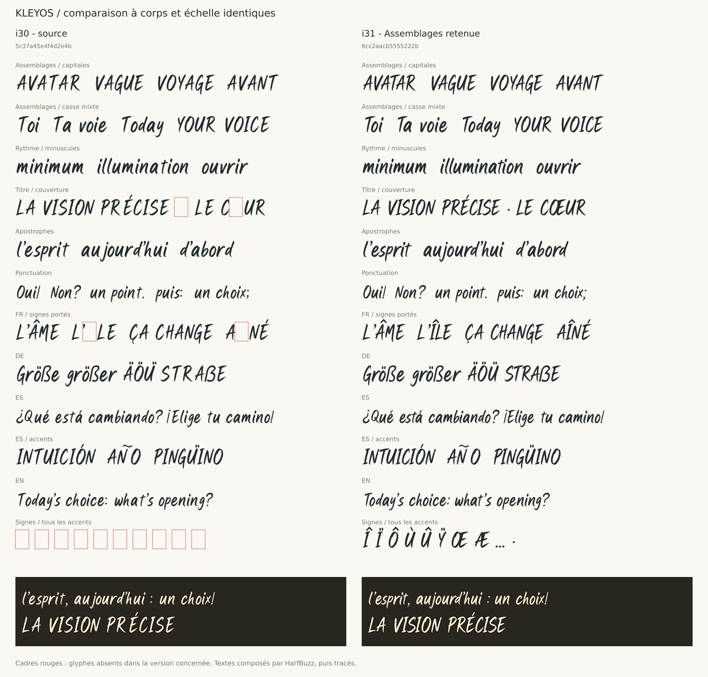

# Kleyos 1.2.0

Kleyos est une famille manuscrite / brush en deux variantes :

- **Kleyos Display** : titres, cartes, grands corps.
- **Kleyos Text** : phrases courtes avec un espace entre mots un peu plus large.

Cette version publique **1.2.0** correspond à **H2-i31 Assemblages**.
Les dessins et les tables de positionnement d'i31 sont conservés. Les noms
internes publics restent **Kleyos Display** et **Kleyos Text** pour assurer la
continuité avec la publication précédente. Le numéro OpenType est **1.310**.



## Fichiers

- `fonts/ttf/Kleyos-Display.ttf`
- `fonts/ttf/Kleyos-Text.ttf`
- `fonts/woff2/Kleyos-Display.woff2`
- `fonts/woff2/Kleyos-Text.woff2`
- `css/kleyos.css`
- `dist/Kleyos-1.2.0-Public-Release-RFN.zip`
- `manifest.json` et `SHA256SUMS.txt`

## Installation et utilisation web

Installer les deux TTF, puis choisir **Kleyos Display** ou **Kleyos Text** dans
l'application. Pour héberger la police soi-même, copier ensemble les dossiers
`fonts/woff2/` et `css/`, en conservant leurs chemins relatifs.

Le dépôt public peut aussi être servi par jsDelivr avec une version fixe :

```html
<link rel="stylesheet" href="https://cdn.jsdelivr.net/gh/nicro33/kleyos-font@b4412dec8b36b763e583524f922d0ebc2b91d3d6/css/kleyos.css">
<h1 class="kleyos-display">L’ÂME — LE CŒUR</h1>
<p class="kleyos-text">¿Qué está cambiando? ¡Elige tu camino!</p>
```

Les deux variantes partagent le même dessin : leur espace entre mots mesure
250 unités (Display) et 270 unités (Text). Elles ne sont pas deux dessins
optiques distincts.

## Couverture et contrôles

170 points de code, avec une couverture ciblée pour les exemples FR/EN/DE/ES
du projet. Certains signes courants (`&`, `@`, `#`, `€`, entre autres) restent
absents. La couverture **GF Latin Core** est incomplète.

Les contrôles d'i31 et le contrôle des tables avant/après renommage sont
documentés dans `qa/` et `manifest.json`. Les rapports FontBakery Google Fonts
conservent les échecs, avertissements et contrôles ignorés ; ce dépôt ne
revendique pas d'admission au catalogue Google Fonts.

Les lignes d'i31 sont environ 4 à 8 % plus courtes que celles d'i30 dans les
échantillons comparés. Vérifier les retours à la ligne lors de l'intégration.
La vérification des rendus réels sur les navigateurs et systèmes visés reste
à compléter.

## Reproduire les binaires publics

```sh
python -m pip install -r sources/requirements.txt
python sources/build_public.py
```

Ce script applique les métadonnées publiques aux deux TTF i31 inclus et
vérifie la conservation des autres tables. Les sources de dessin éditables
et la chaîne de fabrication attendues pour Google Fonts restent à préparer.

Voir [le processus de publication et les étapes Google Fonts](documentation/PUBLICATION.md).

## Licence

Kleyos est distribuée sous **SIL Open Font License 1.1 (OFL-1.1)**.

**Reserved Font Name: Kleyos**

## Auteur

Nicolas Gros
